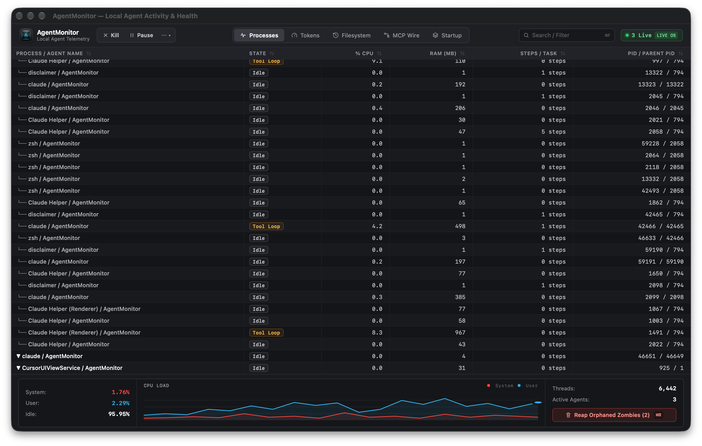

<div align="center">
  
  <h1>AgentMonitor</h1>
  <p><b>The Activity Monitor for local AI coding agents.</b></p>
  <p>Monitor, pause, inspect, and rewind Claude Code, Cursor, Codex, ChatGPT Operator, and child MCP servers — with <b>zero mock data</b>.</p>

  <p>
    <a href="https://github.com/rudraptpsingh/AgentMonitor/releases"></a>
    <a href="https://tauri.app"></a>
    <a href="https://www.rust-lang.org"></a>
    <a href="https://react.dev"></a>
    <a href="https://tailwindcss.com"></a>
    <a href="https://modelcontextprotocol.io"></a>
    
    <a href="LICENSE"></a>
  </p>
</div>

<p align="center">
  
</p>

---

## Why AgentMonitor?

Local AI coding agents run with direct terminal access, spawning background PTY shells, recursive sub-agents, and stdio Model Context Protocol (MCP) servers. When things go wrong, developers are left in the dark:

- **Runaway Token Burn:** A modified system prompt or `CLAUDE.md` breaks prompt caching, causing a **20x billing spike** that drains a 5-hour quota in 10 minutes.
- **Detached MCP Zombies:** When an agent exits or crashes, child `node` and `python` MCP processes stay alive with paused `stdin`, hogging CPU cores, locking `.git/index.lock`, and blocking dev ports.
- **Runaway Loops & 100% CPU Hangs:** Recursive tool-call traps or circular JSON serialization lock terminal sessions without warning.
- **Git Tree Corruption:** A hallucinated multi-file batch refactor leaves uncommitted merge conflicts. Running `git reset --hard` destroys your own uncommitted work.
- **Silent Credential Leaks:** Outgoing MCP wire packets inadvertently dump `.env` files, API keys, or AWS tokens into remote session logs.

**AgentMonitor** solves these challenges by combining a high-performance native desktop dashboard modeled faithfully after **macOS Activity Monitor** with a **Model Context Protocol (MCP) server** that lets agents self-monitor and self-heal in real time.

---

## Key Views & Telemetry

### 1. Processes & Zombies (`Tab 1`)
- **Live OS Telemetry:** Scans active processes using `sysinfo` and Darwin `libproc` / Win32 `tasklist`.
- **Process Hierarchy Tree:** Visualizes parent agent PTY shells and all child MCP servers (`Claude Helper`, `CursorUIViewService`, `Codex Renderer`, `node`, `python`).
- **Zombie Detection:** Automatically flags detached helper processes whose PPID is `1` (init/launchd).
- **Runaway Loop Warning:** Badges processes stuck in recursive tool execution loops.
- **Instant Controls:**
  - `[ ⏸ Pause (SIGSTOP) ]`: Non-destructively suspends a runaway agent loop without closing the terminal session.
  - `[ ✕ Kill ]`: Terminates the selected agent and its entire descendant process tree.
  - `[ 🗑 Reap Orphaned Zombies (⌘R) ]`: One-click sweep of all detached child processes, releasing locked files and ports.

### 2. Token Impact & Burn (`Tab 2`)
- **Prompt Cache Debugger:** Detects broken cache breakpoints in real-time (`94.2% Hit` vs `23.8% BUST!`). Pinpoints which file edit invalidated the cache prefix.
- **Real-Time Burn Flame Graph:** 60-second live area visualization decomposing token consumption into **System/Context**, **Reasoning**, and **Output**.
- **Rate Limit Quota Countdown:** Live countdown until the rolling 5-hour / RPM quota resets, displaying your **P90 Safe Headroom** to prevent 429 lockouts.
- **Cold-Start Optimizer:** `[ ⚡ Strip Idle MCPs ]` sheds unneeded tool schemas from the system prompt, saving up to **42,000 tokens per turn**.

### 3. Filesystem & Merkle Rewind (`Tab 3`)
- **15ms Time-Travel Rollback:** Every agent prompt turn is snapshotted into an isolated shadow Merkle tree (`.git/agentinternals_index`).
- **Selective Turn Rewind:** `[ ⏪ Rewind Selected Turn ]` restores the working tree to the exact state before a bad agent turn without touching your manual edits.
- **Live Guardrails:** Out-of-bounds file access interceptor automatically blocks attempts to overwrite `.env`, `.git/`, or private keys.

### 4. MCP Wire & Protocol Telemetry (`Tab 4`)
- **Captured Packet Stream:** Live inspection of all JSON-RPC 2.0 tool calls, latency (ms), and payload sizes.
- **Secret & Credential Scrubber:** Scans outgoing tool arguments for leaked secrets (`sk-ant-...`, `sk-proj-...`, `ghp_...`, AWS tokens) and replaces them with sanitized tokens.
- **Tool Loop Breaker:** Detects repeating identical commands (e.g. 5x consecutive failed `grep` or `eval` calls) and flags them for intervention.

### 5. Startup Context & Autoruns (`Tab 5`)
- **Static BPE Token Auditor:** Computes exact BPE token weights (`cl100k_base`) for `CLAUDE.md`, `.cursorrules`, plugins, and MCP manifests before typing a prompt.
- **200K Context Window Bar:** Visualizes static pre-prompt overhead against available reasoning headroom.
- **Context Profile Switcher:** Toggle between Lean and Full developer profiles with one click.

---

## Communicating with Agents via MCP

AgentMonitor includes a built-in **Model Context Protocol (MCP)** server (`mcp-server/index.mjs`). This allows Claude Code, Cursor, Codex, and other AI coding agents to communicate directly with AgentMonitor over stdio JSON-RPC 2.0 to make faster, safer decisions autonomously.

### Quick Setup

#### 1. Claude Desktop
Add to `~/Library/Application Support/Claude/claude_desktop_config.json` (macOS) or `%APPDATA%\Claude\claude_desktop_config.json` (Windows):

```json
{
  "mcpServers": {
    "agent-monitor": {
      "command": "node",
      "args": ["/path/to/AgentMonitor/mcp-server/index.mjs"]
    }
  }
}
```

#### 2. Claude Code CLI
```bash
claude mcp add agent-monitor node /path/to/AgentMonitor/mcp-server/index.mjs
```

#### 3. Cursor
Add to your project `.cursor/mcp.json`:

```json
{
  "mcpServers": {
    "agent-monitor": {
      "command": "node",
      "args": ["/path/to/AgentMonitor/mcp-server/index.mjs"]
    }
  }
}
```

### Available MCP Tools for Agents

| Tool Name | Parameters | Purpose / Autonomous Action |
|---|---|---|
| `get_agent_health` | `{}` | Returns live CPU %, RAM, active processes, and zombie counts. Agents self-check before launching heavy background tasks. |
| `check_zombies` | `{}` | Scans for detached child processes and warns if port or file lock contention risk is elevated. |
| `reap_zombies` | `{ force?: boolean }` | Sweeps and terminates all orphaned zombie helper processes. |
| `get_quota_status` | `{}` | Returns rate limit window countdown, token burn rate, and P90 headroom so agents self-throttle *before* triggering a 429 error. |
| `create_checkpoint` | `{ summary: string }` | Creates an isolated Merkle shadow snapshot before executing risky multi-file edits or shell commands. |
| `rollback_turn` | `{ snapshotId?: string }` | Automatically restores workspace files in 15ms if a test suite or build fails after an agent turn. |
| `strip_idle_mcps` | `{ sessionId?: string }` | Strips inactive tool schemas from system prompt to restore prompt caching and shed cold-start token weight. |
| `audit_context_files` | `{}` | Computes static BPE token weights for `CLAUDE.md`, `.cursorrules`, and configs against the 200k window ceiling. |

---

## User Actions & Keyboard Shortcuts

| Action | Shortcut | Description |
|---|---|---|
| **Reap Zombies** | `⌘R` | Immediately sweeps the OS process table and terminates detached child processes. |
| **Search / Filter** | `⌘F` | Focuses the search capsule to instantly filter processes, sessions, checkpoints, or tool packets. |
| **Pause Agent** | — | Sends `SIGSTOP` to pause the selected agent process without destroying its shell or context. |
| **Resume Agent** | — | Sends `SIGCONT` to resume execution after inspecting or freeing resources. |
| **Kill Process Tree** | — | Forcefully kills the selected agent and all child MCP servers. |
| **Rewind Turn** | — | Restores the working tree from the selected Merkle snapshot in 15ms. |
| **Strip Idle MCPs** | — | Removes inactive tool schemas from the system prompt to protect prompt cache breakpoints. |
| **Toggle Scrubber** | — | Enables live redaction of secrets, API keys, and private tokens from MCP packets. |

---

## Architecture

```
AgentMonitor
├── src/                          # React 19 + Tailwind CSS v4 Frontend
│   ├── App.tsx                   # Activity Monitor 3-zone toolbar, table & footer deck
│   ├── index.css                 # macOS native theme, segmented controls, tabular figures
│   └── services/agentApi.ts      # Dual-mode client (Tauri IPC + fallback HTTP bridge)
├── src-tauri/                    # Rust Native Desktop Backend (Tauri v2)
│   ├── src/
│   │   ├── lib.rs                # App entrypoint, plugin initialization & IPC handlers
│   │   ├── commands/             # Process, token, rewind, wire & startup handlers
│   │   ├── engine/               # Live sysinfo scanner, git2 Merkle index, BPE tokenizer
│   │   └── models/               # Strongly-typed Rust data models
│   ├── tests/engine_tests.rs     # Integration test suite (5/5 passing)
│   └── tauri.conf.json           # Native window geometry, security & permissions
└── mcp-server/                   # Model Context Protocol (MCP) Bridge
    ├── index.mjs                 # Stdio JSON-RPC 2.0 server for Claude, Cursor & Codex
    └── package.json              # MCP standalone metadata
```

### Zero Mock Data Commitment
Every metric displayed in AgentMonitor is derived from live system telemetry:
- **Process table:** Real PID, PPID, CPU %, and RSS memory from OS kernel tables.
- **Token telemetry:** Derived from local `~/.claude/projects/` and `~/.cursor/` session logs.
- **Rewind engine:** Real git object trees created via `git2` / shadow index.
- **Context weights:** Real BPE token counting using `cl100k_base` vocabulary.

---

## Getting Started

### Prerequisites
- **Node.js** >= 18 (Node 22 or 24 recommended)
- **Rust** >= 1.75 (`rustup update stable`)
- **pnpm** or **npm**

### Quickstart

1. **Clone the repository:**
   ```bash
   git clone https://github.com/your-username/AgentMonitor.git
   cd AgentMonitor
   ```

2. **Install dependencies:**
   ```bash
   npm install
   ```

3. **Run the Vite dev server:**
   ```bash
   npm run dev
   ```

4. **Launch the native Tauri desktop app:**
   ```bash
   npm run tauri dev
   ```

5. **Test the MCP server:**
   ```bash
   npm run mcp
   ```

### Running Tests

```bash
# Rust engine tests (sysinfo scanner, Merkle checkpointing, BPE tokenizer, wire interceptor)
cd src-tauri && cargo test

# Frontend typecheck & production build
npm run build
```

---

## License

MIT License. Built for developers building with Claude Code, Cursor, Codex, and Model Context Protocol (MCP).
